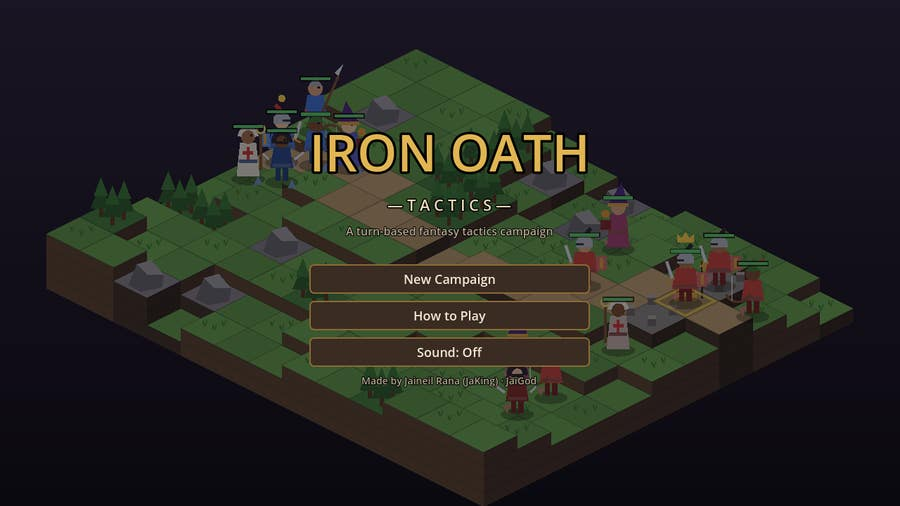
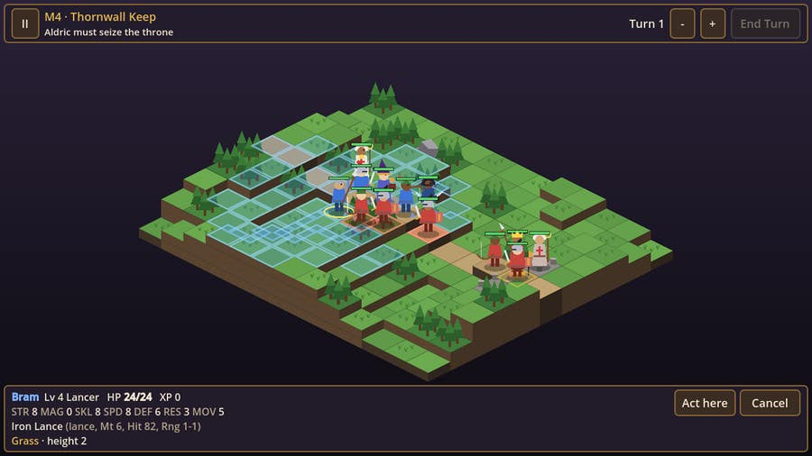
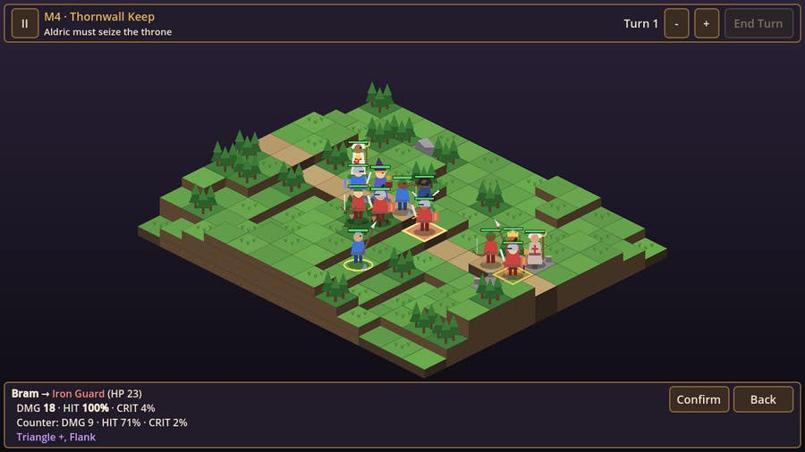
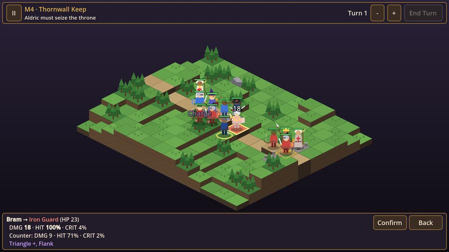
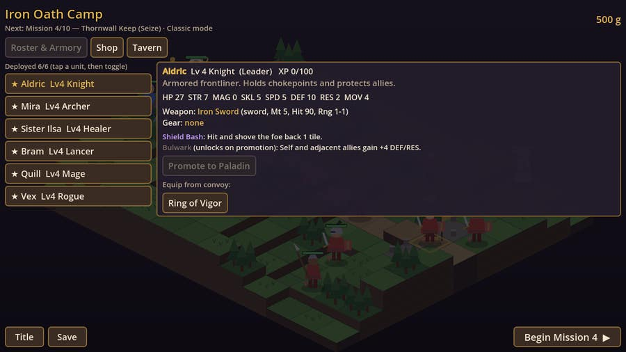
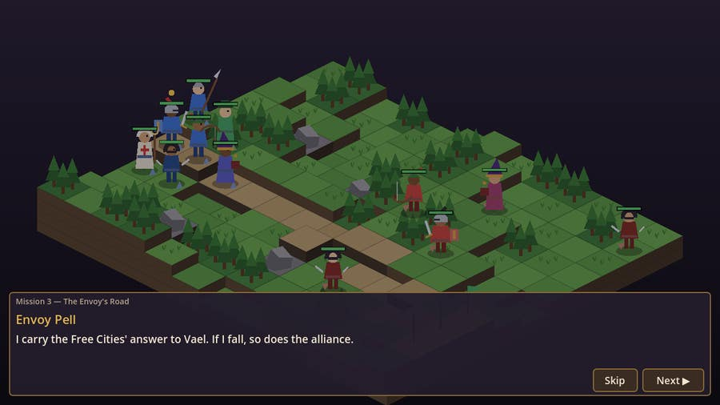
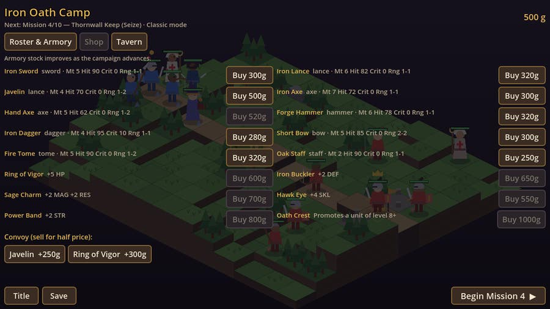
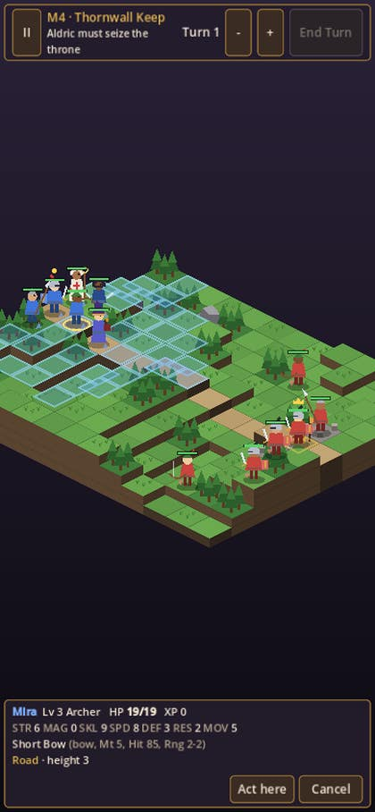

# ⚔️ IRON OATH TACTICS ⚔️

**An original grid-based, turn-based fantasy tactics RPG made in Godot 4.**
Lead the Iron Oath mercenary company through ten story missions to break Warlord Vael's grip on Elderreach.

---

## 📸 Screenshots

| Battlefield | Combat forecast |
|:--:|:--:|
|  |  |
| **Abilities & combat** | **Camp: roster & armory** |
|  |  |
| **Story between missions** | **Shop** |
|  |  |

<b>Phone layout (390×844, touch)</b> 

## ✨ Features

- 🗺️ **Isometric grid with height**: hills up to 3 levels, forest, marsh, rivers with bridges, rocks, forts, gates and thrones. Height adds damage and hit, and gives archers +1 range from high ground.
- 🔺 **Weapon triangle**: swords & daggers > axes & hammers > lances > swords (+15% damage and +15 hit). Magic targets RES instead of DEF.
- 🧭 **Facing & backstabs**: every unit faces a direction (the arrow at its feet). Side hits deal +20%, back hits +50% with +20 crit. Rogues deal double damage from behind.
- 🛡️ **Cover**: rocks, forests and engineer-built barricades give -20 hit against ranged attacks.
- 🤖 **Enemy AI** that scores every reachable tile × target × ability: it focuses wounded and fragile units (healers, mages, the envoy), avoids your threat zones, prefers cover and high ground, uses backstabs and heals its allies.
- 🧙 **8 classes**, each with a weapon type and two abilities (the second unlocks on promotion):

| Class → Promotion | Weapon | Abilities |
|---|---|---|
| Knight → Paladin | Sword | Shield Bash (push), Bulwark (+DEF aura) |
| Archer → Ranger | Bow | Aimed Shot (+range), Arrow Rain (area) |
| Mage → Archmage | Tome | Fireball (area), Frost Lance (slow) |
| Healer → Saint | Staff | Mend, Sanctuary (area heal) |
| Rogue → Assassin | Dagger | Shadowstep (blink + backstab), Poison Blade |
| Lancer → Dragoon | Lance | Charge (line rush), Skewer (pierce) |
| Engineer → Artificer | Hammer | Barricade (build cover), Turret (summon) |
| Beastmaster → Warden | Axe | Call Wolf (summon), Roar (weaken) |

- 📜 **10-mission campaign**: Rout, Defend (hold the gate for N turns with reinforcement waves), Escort (bring the envoy or refugees to the exit) and Seize (Aldric claims the throne). Bosses, recruits and a short story scene before and after every mission.
- 💀 **Classic (permadeath) or Casual** mode.
- 📈 **Progression**: XP and level-ups with per-class growth rates, promotion at level 8 with an Oath Crest, weapons in three tiers, accessories, a shop that improves as you advance, and a tavern for hiring mercenaries.
- 💾 **Saves to `user://`** automatically after every victory (IndexedDB in the browser), plus a manual Save button in camp.
- 🎨 **Everything drawn in code**: tiles, trees, castles, units and effects are `_draw()` calls; every sound is synthesized at startup. No image or audio files.
- ✨ **Juice**: damage numbers, crit screen shake, particles, attack lunges, level-up popups and phase banners. Pause menu with sound toggle and 2× speed.

## 🎮 Controls

| Action | Mouse / touch | Keyboard |
|---|---|---|
| Select a unit | Tap / click a blue unit | |
| Move | Tap a blue tile | |
| Act | Attack / ability / Wait in the action bar | |
| Preview & confirm | Tap a red tile, then tap again or press **Confirm** | |
| Inspect enemy range | Tap an enemy | |
| Pan / zoom | Drag · mouse wheel or **+ / -** | |
| Cancel / pause | **Undo / Back** buttons, **II** | `Esc` |
| End turn | **End Turn** | `E` |

## 🧱 Tech stack

- **Godot 4.3** (GDScript), **Compatibility renderer** (`gl_compatibility`) so the web build runs everywhere
- Web export with **threads disabled**, so it works on GitHub Pages without COOP/COEP headers
- **GitHub Actions** with `barichello/godot-ci:4.3`: headless smoke test → Web export → screenshots under Xvfb → GitHub Pages

## 🗂️ Project structure

| Path | What it does |
|---|---|
| [`scripts/data.gd`](scripts/data.gd) | Classes, weapons, gear, abilities, terrain, missions and story |
| [`scripts/battle.gd`](scripts/battle.gd) | Pure rules: map generation, movement, combat math, abilities, objectives, enemy AI |
| [`scripts/board.gd`](scripts/board.gd) | Isometric renderer (code-drawn tiles and units), picking, pan/zoom, effects |
| [`scripts/hud.gd`](scripts/hud.gd) | Battle controller: selection state machine, action bar, forecasts, enemy phase |
| [`scripts/camp.gd`](scripts/camp.gd) | Camp: roster & deployment, armory, promotion, shop, tavern |
| [`scripts/main.gd`](scripts/main.gd) | Screens: title, mode select, how-to, story, results, ending |
| [`scripts/game.gd`](scripts/game.gd) | Campaign state, leveling, inventory, save/load (autoload) |
| [`scripts/sfx.gd`](scripts/sfx.gd) | Procedural sound effects (autoload) |
| [`tests/smoke.gd`](tests/smoke.gd) | Headless smoke test run in CI |
| [`tests/shots.gd`](tests/shots.gd) | Screenshot capture under Xvfb |
| [`web/index.html`](web/index.html) | Landing page served at `/` (the game lives at `/play/`) |
| [`.github/workflows/pages.yml`](.github/workflows/pages.yml) | CI: test, export, deploy |

## 🛠️ Run locally

1. Install [Godot 4.3](https://godotengine.org/download) (standard build).
2. Clone the repo and open `project.godot`, then press **F5**.
3. Smoke test: `godot --headless --path . --import && godot --headless --path . res://tests/Smoke.tscn`
4. Web build: install the 4.3 export templates, then `godot --headless --path . --export-release "Web" build/play/index.html` and serve `build/` with `python3 -m http.server`.

## 📓 Development log

- **Design.** I wanted a tactics game where *positioning* matters more than raw stats, so every attack checks four things: weapon triangle, height difference, the defender's facing and cover. The combat forecast shows each bonus by name, so players learn the rules by playing.
- **Rules separate from rendering.** `battle.gd` is a plain `RefCounted` with no nodes, so the whole campaign can be simulated headless. I used that to balance: an AI-vs-AI harness played every mission with a party of the expected level, and I tuned enemy growth (enemies grow about 15% slower than your company), mission 1 and 2 enemy counts and the defend timers until a naive bot wins most of them.
- **Enemy AI.** Each enemy scores every reachable tile × action × target: expected damage, kill bonus, missing-HP and fragile-class bonuses, backstab bonus and counter risk, plus tile value (terrain DEF/AVO, height, adjacent cover) minus a *danger map* of how many of your units could hit that tile next turn. Wounded enemies weight danger 3× higher, so they fall back into forests instead of suiciding. Without a target they path toward the objective or the weakest unit using a terrain-cost flood fill.
- **Maps.** Missions use seeded procedural maps (value-noise heights, forest clusters, rivers, a winding road with bridges) so each one is the same every time but hand-tuned by parameters. A connectivity pass flood-fills from the player spawn with the jump rules and carves a path to any unreachable spawn, gate, throne or exit.
- **Challenges & fixes.**
  - Godot's `--script` mode doesn't load autoloads, so the smoke test runs as a scene (`res://tests/Smoke.tscn`) instead.
  - GDScript can't infer types from `Dictionary`/untyped `Array` values; I typed those variables explicitly.
  - A helper named `_set()` silently clashed with `Object._set()`; renamed to `set_tile()`.
  - On phones the 1280×720 canvas made text tiny, so the window switches to a 560×980 logical size in portrait and the HUD stacks vertically; the board also zooms in so tiles stay tappable (drag to pan).
  - Enabling 2D MSAA printed warnings in the browser console with GLES3, so I removed it.
  - The escort envoy started at the front and died on turn 1; it now spawns behind the party with HP and DEF that scale per mission.
- **Testing.** CI runs the smoke test (UI flow, selecting/moving/undo through the real HUD, full HUD-driven battles, camp shop/equip/promote/hire, save/load, permadeath, and a validity check plus ability use and an AI turn on all 10 maps) before exporting.
- **Beta tested on the live site ✅** (2026-11-05): started a Classic campaign on the GitHub Pages build, started Classic and Continue (save restored from IndexedDB), went through camp, the story, unit selection, movement, Wait and the enemy phase of mission 1 with mouse input; no console errors. The test caught three symbols (a star, a play triangle and an arrow) that the web build's default font cannot draw, so they were swapped for » and ·.

## 🔗 Links

- ▶ **Play:** <https://jaigod.github.io/iron-oath-tactics/play/>
- 🏠 **Landing page:** <https://jaigod.github.io/iron-oath-tactics/>
- 📦 **Source:** [`scripts/`](scripts) · [`tests/`](tests) · [`web/`](web)
- 🧑‍💻 **More games from the studio:** [JaiGod on GitHub](https://github.com/JaiGod)
- 🎲 **Related JaiGod games:** [Runebound Saga](https://github.com/JaiGod/runebound-saga) (Godot party RPG) · [The Hollow Between](https://github.com/JaiGod/the-hollow-between) (story RPG) · [Arcane Deck](https://github.com/JaiGod/arcane-deck) · [Isle of Embers](https://github.com/JaiGod/isle-of-embers) · [Bulwark TDS](https://github.com/JaiGod/bulwark-tds)

## 📄 License

[MIT](LICENSE) © 2026 Jaineil Rana. All art and audio are generated in code. The characters, world and story are original.

---

Made by Jaineil Rana (JaKing) · part of <a href="https://github.com/JaiGod">JaiGod</a>

